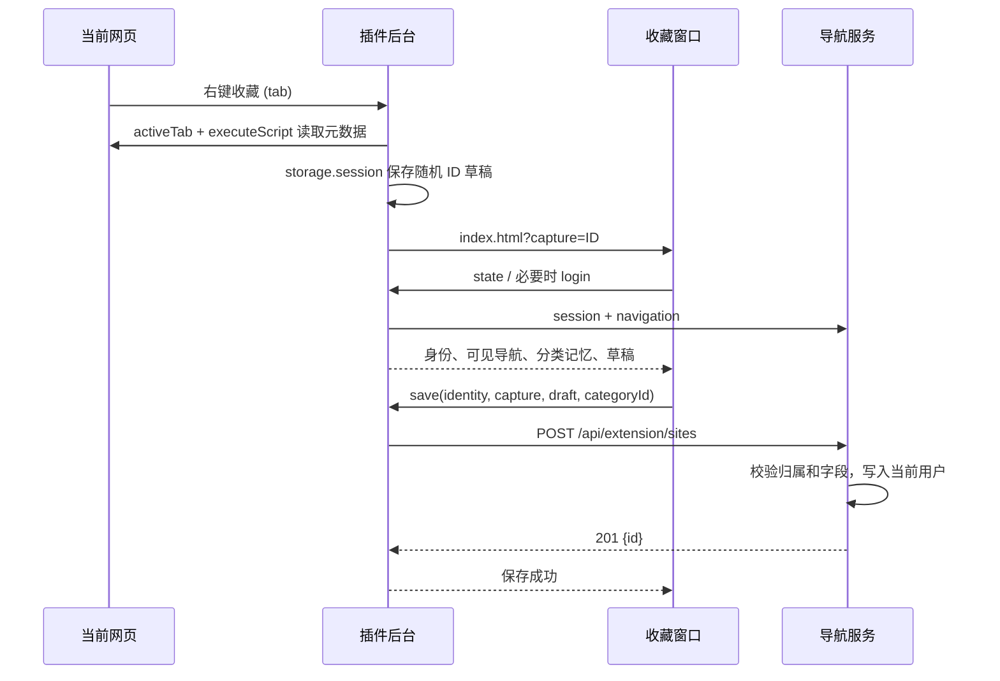

# QiangMacNav 插件开发文档

## 现有网站功能逻辑

网站使用 React 19 / TypeScript / Vite、Go / Chi API、SQLite。插件沿用下面的服务端逻辑：

| 现有逻辑 | 实现 | 插件行为 |
| --- | --- | --- |
| 首次账号为管理员，后续注册普通用户，注册可关闭 | main.go register / bootstrap | 仅登录已有账号，身份取 session.role |
| 账号大小写不敏感、Unicode 字符校验、IP / 账号限流、密码计算并发限制 | main.go、password.go、auth_security.go | 复用 login，前端复用 src/accountValidation.ts |
| 分类 / 站点都有 owner_id | schema.go、createSite | 自动归属当前用户，不接受客户端归属参数 |
| 本人内容 + 启用的管理员主动共享分类可见 | sharing.go 的 visibleCategoriesSQL / visibleSitesSQL | 直接复用 navigation，避免两套权限 SQL |
| 共享内容仅所有者能编辑，包括其他管理员也是只读 | validCategory、editable | shared / editable 控制界面，服务端最终校验 |
| 侧栏顺序按用户保存；站点按 position / id 排序 | navigation、sidebar_order | 应用 sidebarOrder，剩余分类按 position / id 排序 |
| 未分类的 categoryId 为 null | siteInput | 提供「未分类」收藏目标 |
| 登录日志个人隔离，管理员可看全站 | accounts.go | 明确记录和展示 web / extension 来源 |
| 改密、重置、禁用和退出其他设备撤销会话 | accounts.go | 插件沿用 sessions 表和撤销链路 |
| 网页 Cookie + Origin 同源检查 + 严格 JSON | checkOrigin、requireUser | 独立 Bearer API，不扩大网页白名单 |

管理员身份不授予读取其他用户私有导航或编辑其他管理员共享分类的权限。网站的 Dock、桌面快捷方式、分类 Launchpad、排序、媒体库和偏好仍由网页管理；插件聚焦浏览与收藏。

## 目录与构建

```text
extensions/qiangmacnav/
  public/manifest.json       MV3 与安装权限
  index.html                 弹出页 / 收藏窗口共同入口
  vite.config.ts             独立多入口构建，后台 ES module
  src/background.ts          菜单、采集、API、令牌、存储、消息串行队列
  src/capture.ts             自包含的页面元数据读取函数
  src/model.ts               消息协议、类型、URL 与分类规则
  src/main.tsx               登录、身份、导航、搜索、收藏表单
  src/style.css              深浅主题、窄屏与字段样式
  scripts/icons.mjs          本地生成原创 PNG 图标
  tests/model.test.mjs       地址、分类回退与采集逻辑测试
  dist/                      生成的可加载目录，忽略版本控制
```

根项目 lint 同时检查插件 TS / TSX；build 构建网站，build:extension 构建插件。依赖均来自根 package.json，JS / CSS / React 均本地打包，遵循 MV3 CSP。表单直接复用 MacInput / MacTextarea 及 form-controls.css，不关闭自动填充。

## 登录与数据库升级

`/api/extension` 中间件：extensionClient → updateMaintenance → requireExtensionUser（login 除外）。extensionClient 在上下文中标记来源，loginSource() 据此写日志和会话，客户端无法通过 JSON 指定来源或角色。

插件登录使用独立 Bearer 会话，复用密码校验及限流，创建随机 32 字节令牌。数据库保存 SHA-256 摘要、空闲到期时间和绝对到期时间。前台打开、操作和提交收藏通过 `POST /api/extension/session/activity` 续期，后台轮询仅校验。每 24 小时最多更新一次，到期时间取当前时间加 30 天与登录时间加 90 天中的较早值。插件通过返回的 `expiresAt` 更新本地会话。每次受保护请求实时检查账号状态和会话有效期。

数据库版本 2 增加会话与日志的 `source` 字段。版本 3 为会话增加 `absolute_expires_at`，旧会话按原本固定的 30 天有效期反推出登录时间。升级在事务中完成。

请求使用 credentials:omit、redirect:error、cache:no-store 和 15 秒超时。仅 401 清除登录；503、429 和网络失败保留会话。退出失败仍清除本机登录，但提示服务器会话未确认撤销，可在网页「退出其他设备」撤销。

Origin 非空时只接受合法 `chrome-extension://<32 位 a–p ID>`，精确回显 Origin，不开放凭据 CORS。OPTIONS 允许 GET / POST 及 Authorization / Content-Type。无 Origin 的非浏览器客户端可用密码 / Bearer 协议；扩展 Origin **不是身份凭据**，权限不依赖扩展 ID。网页同源校验保持，不需要把插件加入 APP_ORIGIN。

## API 契约

常规接口使用 JSON，图片上传使用 multipart，预览返回图片二进制。除 login 外要求 `Authorization: Bearer <token>`。

| API | 契约 |
| --- | --- |
| POST /api/extension/login | `{username,password}` → `{user:{id,name,username,role,avatarUrl},token,expiresAt}`，expiresAt 为 Unix 秒，不设置 Cookie |
| GET /api/extension/session | 当前 User，role 为 admin / user |
| POST /api/extension/session/activity | 前台活动检查，返回 `expiresAt` 和 `checkAfterSeconds` |
| GET /api/extension/navigation | 网页 navigation 原契约：categories、sites、sidebarOrder、preferences、dockItems、desktopItems、desktopColumns、desktopRows |
| POST /api/extension/sites | `{name,url,logoUrl,note,categoryId}` → 201 `{id}` |
| POST /api/extension/logos | multipart/form-data 的 `file` 字段。上传到当前账号的 image 库，201 返回 `{id,url,name,width,height,size,mime}`。`url` 可作为收藏的 logoUrl 原值保存。部署时需同步更新 Go 后端 |
| GET /api/extension/logos/{id} | 获取本人或当前可见共享内容引用的图标二进制。复用媒体可见性检查 |
| POST /api/extension/logout | `{}` → `{ok:true}`，只撤销当前插件令牌 |

name 去空白后为 1–100 个 Unicode 字符，note 最多 500 字符。外部 url / logoUrl 最长 2048 字符，HTTP(S)，禁止 URL 用户名 / 密码。logoUrl 可空；categoryId 为本人分类 ID 或 null。ownerId、role、scope 等额外字段被拒绝。

分类：`{id,name,position,iconUrl,shared,editable}`。站点：`{id,categoryId,name,url,note,logoUrl,position,shared,editable}`。权限完全复用现有 navigation / validCategory / validateSite / createSite。

## 收藏流程



采集主 frame 的 document.title（为空时 og:title / hostname）、完整 location.href（保留查询和锚点，不改成 canonical）、安全 rel=icon（其次 apple-touch-icon、标签页图标、/favicon.ico）、description（其次 og:description）。相对链接按 document.baseURI 解析；选中文字优先作为备注。限制注入时保留标签页信息，提示手动补充。不采集正文、表单值或 Cookie。

已授权时，工具栏使用原生 action popup，弹出页查询当前窗口的活动标签。需要授权时，工具栏使用 `action.onClicked` 并把事件里的标签 ID 随 `sourceTab` 传入独立窗口。右键直接使用事件中的 tab，每次收藏独立生成 capture ID。

## 入口权限和窗口布局

后台根据保存的 base 和 `permissions.contains` 设置 action popup。安装、启动、主机授权变化或更改导航地址时更新。缺少权限时，点击图标或右键菜单会在浏览器用户手势中读取已保存的 base 并调用 `permissions.request`。首次尚无 base 时先显示地址栏，由「允许访问导航」按钮在确认地址的同一次点击中请求具体主机；拒绝后可以重试。后台在每次 API 调用前仍检查实际授权。

插件从网站导入 `theme-tokens.css` 和 `MacButton`、`MacInput`、`MacTextarea`。登录前跟随系统主题，导航同步成功后使用 `preferences.theme`。收藏窗口使用整窗纵向布局，表单字段独立滚动，分类与操作按钮放在不可收缩的底栏中。账号身份和导航工具只出现在浏览界面。

## 并发、缓存与失败处理

- 后台 Promise 队列串行处理消息；只接受本扩展 index.html 的内部消息。不声明 externally_connectable、content_scripts 或 web_accessible_resources。
- 每个界面合并尚未完成时收到的同步事件，最多保留一次后续刷新，避免焦点切换或网络缓慢时累积请求。
- local 保存 session、base 和 `category:<JSON([base,userId])>`。分类值为 ID 或 null；地址与账号隔离。local / session 均限制 TRUSTED_CONTEXTS。
- 导航只在活动 React 窗口内存；退出 / 换账号 / 401 清空。版本计数避免迟到响应恢复旧账号数据。临时失败可保留同账号旧快照并提示同步失败，同时禁用收藏提交。
- save / category / logout 携带 identity，后台与当前会话核对，旧窗口不能写入新账号。
- 采集信息存 session，24 小时后由下次采集清理，重启浏览器清空。手工编辑只在表单内存，关闭或刷新会丢失；同步不覆盖编辑。
- 同一 capture 成功后标记 saved，防止重复消息再次创建。不同 capture 允许重复 URL，与网页现有规则一致。
- 不自动重试 POST。响应丢失提示先查列表，当前协议不保证网络故障后的严格幂等。确认保存后即使刷新失败也显示「已保存，但列表刷新失败」。
- 按账号记住上次选择；删除 / 不可编辑分类按侧栏顺序回退到第一个本人分类或未分类。共享只读分类不可选。
- 收藏窗口点击「上传」时把当前 `draft.logoUrl` 交给 `src/media.ts`，在用户手势中申请该图片主机权限。插件端匿名 GET 图片，省略 Cookie、Referer 与导航令牌，流式限制为 8 MB、下载超时 20 秒。PNG/JPEG/GIF/WebP 交给现有媒体接口校验；ICO/SVG 在浏览器图片上下文绘制为最长边 1024px 的 PNG。随后核对当前账号，用独立 Bearer 会话向导航上传 multipart。只有上传响应含合法 `/api/media/<id>` 时才替换编辑框；此路径可直接预览和收藏，按钮禁止重复入库。带令牌的请求禁止重定向，切换用户时卸载预览并中止读取。
- 浏览面板上限 520px。MacSelect 从共享样式表加载，收藏下拉保留只读项并禁止选择；站点列表根据已同步快照每次追加 30 项，使用列表内部的 IntersectionObserver，不重新请求整个导航。收藏窗口的定位按源 tab 的 windowId 计算，保留多显示器坐标。

## 自动检查与浏览器验收

```powershell
# 项目根目录
npm run lint
node --test "scripts/*.test.mjs"
npm run test:extension
npm run build
npm run build:extension

# server 目录
go test ./...
go vet ./...
```

server/extension_test.go 覆盖角色、个人数据隔离、共享只读 / 撤回、伪造归属、Cookie / Bearer 隔离、CORS、网页登录 Origin、日志来源、注销、禁用、其他设备撤销和版本 1 数据保留。原有 authorization / sharing / account 测试继续覆盖全站权限。

真实浏览器使用独立 profile 与临时数据库：

1. 验证允许 / 拒绝主机授权、账号错误、断网、503、401、退出与重新登录。
2. 分别用管理员 / 普通用户验证角色、本人和共享分类、他人私有内容不可见、共享撤回后消失。
3. 在有中文标题、相对 favicon、description 的网页右键收藏；检查四个预填字段、选中文字、手动编辑、限制注入时回退。
4. 保存后检查网页出现同一站点；再次收藏恢复分类（含未分类）；换账号 / 地址不复用记忆，删除分类正确回退。
5. 多窗口、切换账号、双击提交、写入时断网：检查不误采集、不跨账号、不自动重发。
6. 检查 320 / 420 / 480px、深浅主题、键盘、输入法、错误关联 / 聚焦、禁用、图标失败后备。
7. 自动填充使用真实浏览器自动填充，或 CDP CSS.forcePseudoState 的 autofill 状态，检查背景 / 字色 / 光标与共享变量一致；脚本 fill 不代表自动填充验证。
8. 网站登录日志明确区分来源；改密、禁用或退出其他设备后插件同步要求登录。

原生右键菜单和授权气泡不属于网页 DOM。自动化可通过浏览器扩展管理设置授予测试主机权限，再验证真实扩展后台和窗口；发布前仍应人工点选原生菜单及授权入口。
